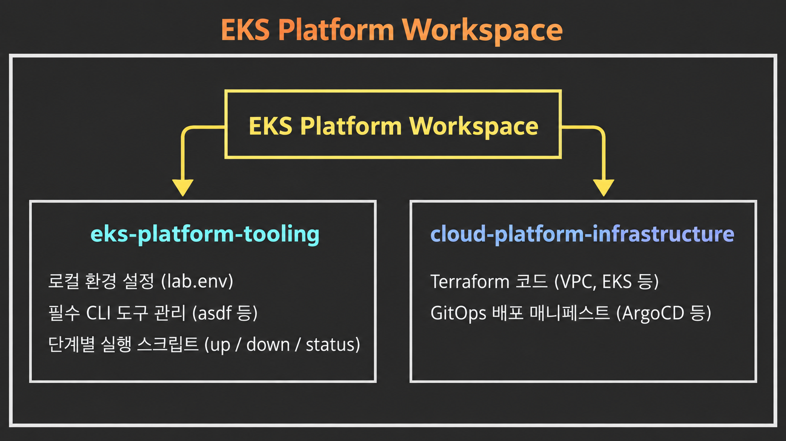
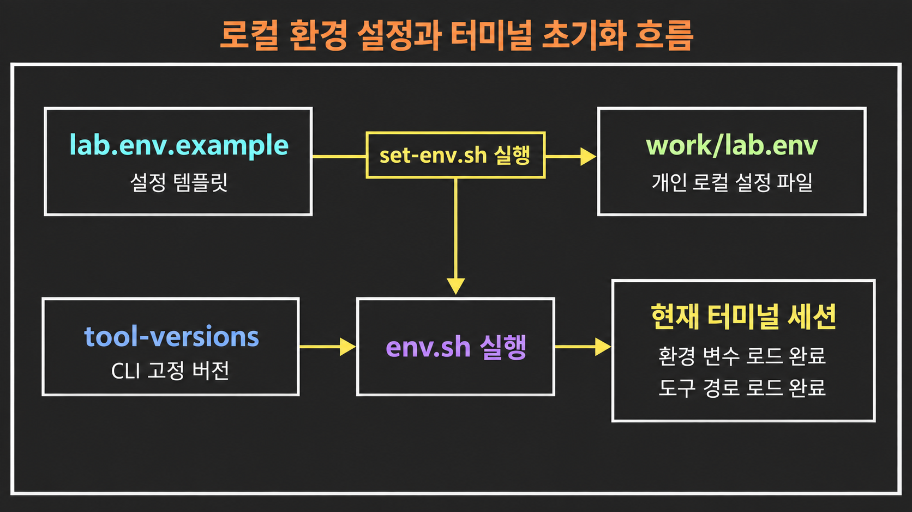
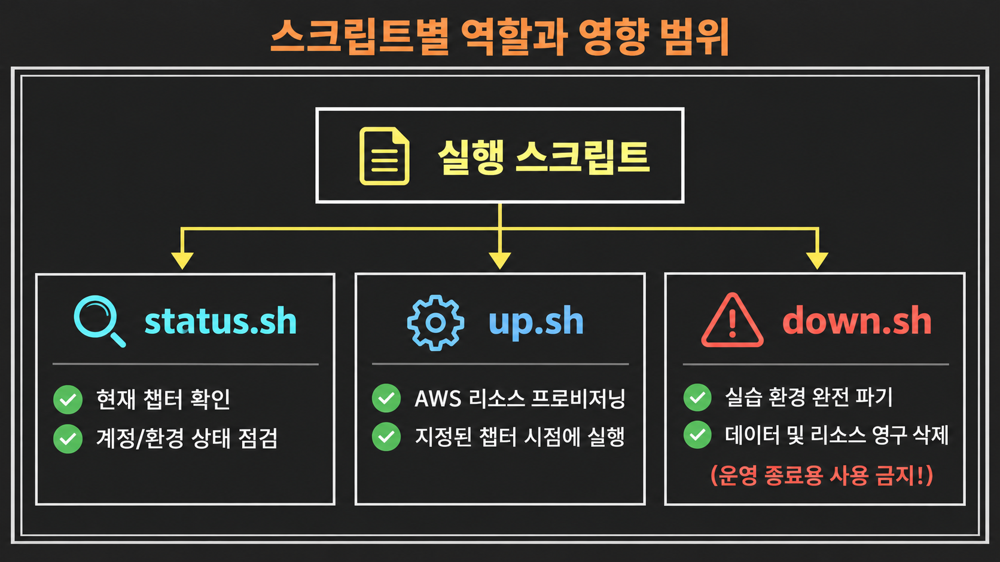

# EKS 플랫폼 툴링 가이드

이 저장소는 EKS 플랫폼 실습과 운영에 필요한 **CLI 도구 버전, 로컬 개발 환경, 반복 실행 스크립트**를 관리하는 공간입니다.

실제 인프라를 프로비저닝하는 Terraform 코드나 애플리케이션을 배포하는 GitOps 매니페스트는 이 저장소가 아닌 `cloud-platform-infrastructure` 저장소에서 별도로 관리합니다.

위 구조처럼 도구 설정과 실제 인프라 코드를 분리해 두었기 때문에, 로컬 환경이 꼬이더라도 인프라 코드에 영향을 주지 않고 안전하게 작업 환경을 맞출 수 있습니다.

---

## 1. 환경 설정 및 도구 설치 흐름

실습을 시작하려면 먼저 개인 환경 설정 파일을 생성하고, 팀 표준 도구들을 동일한 버전으로 맞추는 작업이 필요합니다.

다이어그램의 흐름은 다음과 같은 스크립트로 동작합니다.

* **`scripts/lab/lab.env.example`**

* AWS 계정 ID, 기본 경로, CLI 프로필 이름 등을 정의하는 템플릿 파일입니다.

* **`scripts/lab/set-env.sh`**

* 템플릿을 기반으로 사용자 본인의 설정값을 입력받아 `work/lab.env` 파일에 기록합니다.

* **`scripts/toolchain/env.sh`**

* `work/lab.env`의 환경 변수와 표준 도구 버전을 현재 열려 있는 터미널 셸에 즉시 적용합니다. 새 터미널을 열 때마다 실행해야 합니다.

* **`scripts/toolchain/tool-versions`**

* 실습 구성원 모두가 동일한 버전을 사용하도록 고정한 CLI 도구 버전 목록입니다.

* **`scripts/toolchain/install-tools.sh`**

* 다중 런타임 버전 관리자인 `asdf`와 정책 검증 도구인 `Kyverno CLI`를 설치합니다.

* **`scripts/toolchain/check-tools.sh`**

* 필수 도구들이 올바른 버전으로 설치되었는지 일괄 검증합니다.

* **`scripts/toolchain/render-github.sh`**

* 템플릿 내의 GitHub 조직(Organization) 이름을 본인의 환경에 맞게 자동으로 치환합니다.

### 보안 및 주의사항

* **선행 조건:** 스크립트를 실행하기 전, 안내 문서에 나온 OS별 필수 패키지를 먼저 설치해야 합니다.
* **설정 파일 위치:** 생성된 설정 파일은 항상 `work/lab.env` 경로에 저장되며, `.gitignore` 처리되어 Git 추적에서 제외됩니다.
* **민감 정보 금지:** 비밀번호, API 토큰, SSH 프라이빗 키와 같은 민감한 자격 증명은 `work/lab.env` 파일에도 절대로 평문으로 저장해서는 안 됩니다.

---

## 2. 실습 진행과 인프라 라이프사이클 관리

실습 챕터를 진행하거나 종료할 때는 전용 라이프사이클 스크립트를 사용합니다.

다이어그램에서 볼 수 있듯, 각 스크립트는 실제 클라우드 인프라에 직접적인 변경을 가합니다.

* **`status.sh`**

* 현재 어느 챕터까지 완료했는지, 그리고 올바른 AWS 계정과 환경 변수를 바라보고 있는지 상태를 점검합니다.

* **`up.sh`**

* 현재 챕터에 필요한 AWS 리소스를 자동으로 생성합니다. 스크립트 실행 전, 실습 가이드에서 지정한 단계가 맞는지 반드시 확인해야 합니다.

* **`down.sh`**

* **매우 주의해야 하는 스크립트입니다.** 단순히 인스턴스를 끄는 것이 아니라, 실습 중에 생성된 스토리지 데이터까지 완전히 삭제하는 초기화 스크립트입니다. 운영 환경의 일상적인 리소스 종료 목적으로 사용해서는 안 됩니다.

### 로컬 검증과 클라우드 상태의 차이

`check-tools.sh` 실행 결과가 정상이거나 로컬 문법 검사(Lint)가 통과했다고 해서 AWS 리소스 배포까지 성공했다는 뜻은 아닙니다.

로컬 검사는 "명령을 내릴 준비가 되었는가"만 검증하므로, 실제 EKS 클러스터와 애플리케이션의 정상 동작 여부는 반드시 `kubectl`, AWS 콘솔, 관측(Observability) 도구 명령어를 통해 클라우드 런타임 상태를 직접 확인해야 합니다.
